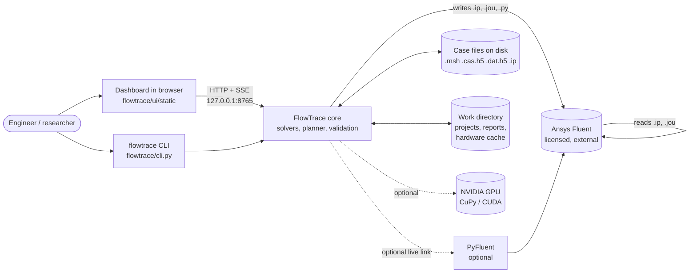
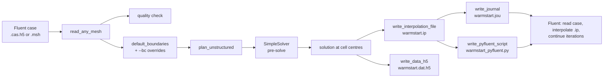
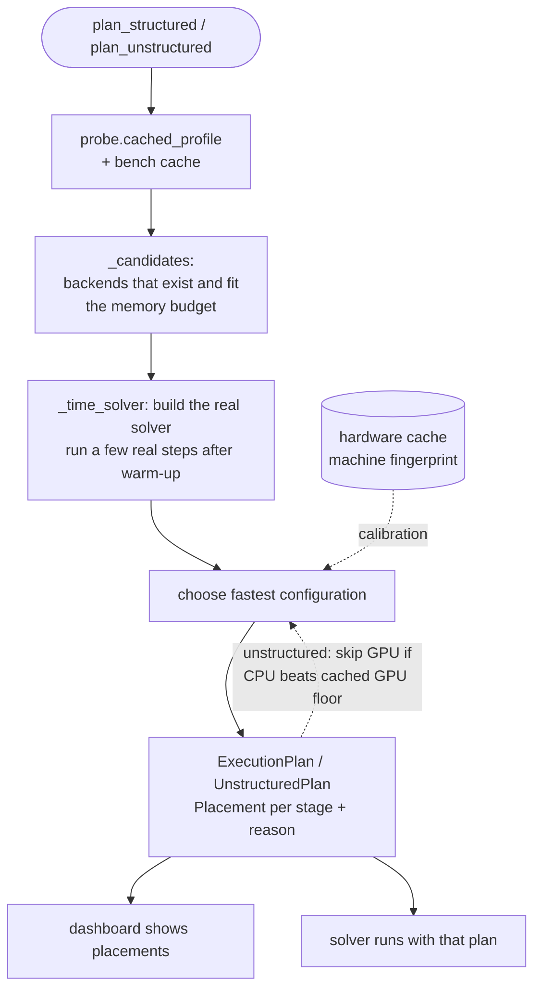
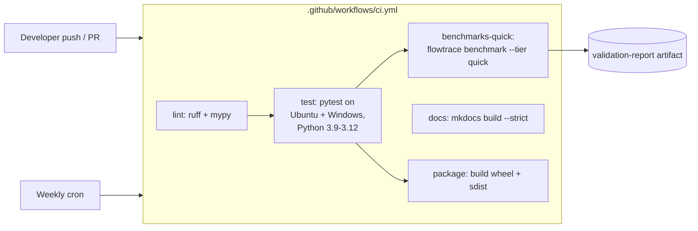

# FlowTrace: System Architecture

This document describes every component in the repository as it is at the current commit
(`claude/beautiful-feynman-i198h1`, 138 tracked files, about 13.6k lines of Python and web code in
`flowtrace/`). It covers what each part does, how the parts depend on each other, and how data moves
through a run. It is a map of the code, not a user guide; the user docs are in `docs/`.

Contents

1. [Purpose and scope](#1-purpose-and-scope)
2. [Context diagram](#2-context-diagram)
3. [Layered architecture](#3-layered-architecture)
4. [Module reference](#4-module-reference)
5. [Key flows](#5-key-flows)
6. [Numerical methods](#6-numerical-methods)
7. [Hardware placement and the planner](#7-hardware-placement-and-the-planner)
8. [Data formats and persistence](#8-data-formats-and-persistence)
9. [Interfaces](#9-interfaces)
10. [Validation and verification](#10-validation-and-verification)
11. [Build, packaging, CI and documentation](#11-build-packaging-ci-and-documentation)
12. [Cross-cutting concerns](#12-cross-cutting-concerns)
13. [Known limitations](#13-known-limitations)
14. [Repository map](#14-repository-map)

---

## 1. Purpose and scope

FlowTrace solves incompressible flow, Boussinesq heat transfer and RANS turbulence. It has three jobs:

* **Solve** small and medium CFD cases on whatever CPU/GPU the machine has. Each stage of the solve is
  placed on the device that a timing measurement says is fastest.
* **Exchange** data with Ansys Fluent: read Fluent meshes (`.msh`, `.cas`, `.cas.h5`), write
  Fluent interpolation files (`.ip`), profiles, journals and PyFluent scripts.
* **Warm-start** Fluent. Pre-solve the case with FlowTrace, hand the field to Fluent, and measure how
  many iterations the warm start saves (the warm-start study).

Non-goals stated in the code and docs: FlowTrace is not a Fluent replacement, not a parallel
distributed solver (single node only), and it does not yet check HDF5 files written by Fluent.

---

## 2. Context diagram



FlowTrace never runs inside Fluent. The handoff is file based (the `.ip` file and a journal), and the
optional live link goes through PyFluent, which needs a licence.

---

## 3. Layered architecture

```mermaid
flowchart TB
    subgraph L5[Interfaces]
        CLI[cli.py]
        UI[ui/server.py + static/]
        Main[__main__.py, start_flowtrace.bat]
    end
    subgraph L4[Orchestration]
        Engine[runtime/engine.py<br/>Job, EventHub]
        Ckpt[runtime/checkpoint.py]
        WS[fluent/warmstart.py]
        Study[fluent/warmstart_study.py]
        Suite[validation/suite.py<br/>benchmarks.py]
    end
    subgraph L3[Planning and placement]
        Planner[hardware/planner.py]
        Probe[hardware/probe.py]
        Bench[hardware/bench.py]
        Mem[hardware/memory.py]
        GPUR[hardware/gpu_report.py]
    end
    subgraph L2[Solvers]
        MAC[structured/solver.py<br/>MACSolver]
        SIMPLE[unstructured/simple.py<br/>SimpleSolver]
        Turb[unstructured/turbulence.py]
        CHT[unstructured/conjugate.py]
        Seq[structured/sequencing.py]
        Cases[structured/case.py<br/>unstructured/case.py]
    end
    subgraph L1[Kernels and linear algebra]
        Backend[hardware/backend.py]
        Numba[structured/kernels.py<br/>Numba]
        CUDA[structured/cuda_kernels.py<br/>NVRTC]
        LA[linalg/*<br/>separable, multigrid, krylov, amg]
    end
    subgraph L0[Data model and I/O]
        Mesh[mesh/*<br/>UnstructuredMesh, Fluent readers and writers]
        FVM[unstructured/fvmesh.py]
        FluentIO[fluent/export.py, convert.py,<br/>interpolate.py, bridge.py]
        H5[mesh/fluent_h5.py]
    end

    CLI --> Engine
    CLI --> WS
    CLI --> Study
    CLI --> Suite
    UI --> Engine
    Engine --> Planner
    Engine --> Ckpt
    Engine --> MAC
    Engine --> SIMPLE
    Engine --> Seq
    WS --> Planner
    WS --> SIMPLE
    Study --> MAC
    Study --> SIMPLE
    Planner --> Probe
    Planner --> Bench
    Planner --> Mem
    Probe --> Backend
    Bench --> Backend
    MAC --> Cases
    SIMPLE --> Cases
    SIMPLE --> Turb
    SIMPLE --> CHT
    SIMPLE --> FVM
    MAC --> LA
    SIMPLE --> LA
    MAC --> Backend
    SIMPLE --> Backend
    MAC --> Numba
    MAC --> CUDA
    FVM --> Mesh
    FluentIO --> Mesh
    FluentIO --> H5
    Suite --> MAC
    Suite --> SIMPLE
```



Dependencies point downward. The only upward references are the interface layer calling into
orchestration, and a few lazy imports inside functions (for example `engine.py` imports the solvers
inside methods). Those lazy imports keep `flowtrace --help` and the probe fast, because they avoid
loading NumPy-heavy solver modules and Numba until they are needed.

---

## 4. Module reference

Line counts are from the current tree. "Public" means it is used from outside its own module.

### 4.1 Package root and entry points

| File | Lines | Role |
|---|---:|---|
| `flowtrace/__init__.py` | 19 | Package docstring. Sets `NUMBA_NUM_THREADS`-related env vars before Numba loads: Numba's OpenMP workers busy-wait, which starves NumPy/SciPy calls (the code records a 10× slowdown). |
| `flowtrace/__main__.py` | 3 | `python -m flowtrace` entry, forwards to `cli.main`. |
| `flowtrace/cli.py` | 428 | argparse-based CLI. Subcommands: `ui`, `probe`, `bench`, `run`, `mesh`, `quality`, `h5-inspect`, `solve`, `fluent-warmstart`, `validate`, `benchmark`, `warmstart-study`, `gpu-report`, `parse-transcript`. Installed as the `flowtrace` console script. Default command is `ui`. |
| `start_flowtrace.bat` | - | Windows one-click launcher. Creates `.venv`, picks Python 3.13 to 3.10, installs the extras, adds CuPy when `nvidia-smi` finds a GPU, reinstalls only when the version or GPU situation changes, then starts the dashboard. |

### 4.2 `hardware/`: discover, measure, place

| File | Lines | Role |
|---|---:|---|
| `backend.py` | 140 | Array backend abstraction. `Backend(name, device_index)` for `numpy`, `numba` (CPU JIT) and `cupy` (GPU). Exposes `asarray`, `to_numpy`, `scalar`, `synchronize`, `timer`, `mem_info`, `free_pools`, `supports_transform` (which FFT/DCT kinds exist on the device). `get_backend()` and `available_backends()` are the only factory functions. Raises `BackendUnavailable` when CuPy or CUDA is missing. |
| `probe.py` | 416 | Hardware discovery. Builds a `SystemProfile` (CPU model, physical cores, SIMD flags, RAM, battery state, library versions) and a list of `GPUInfo` (name, memory, compute capability, classification). GPU discovery tries CuPy first, then `nvidia-smi`. `cached_profile()` memoises the result. |
| `bench.py` | 164 | Micro-benchmarks per backend: triad (memory bandwidth), GEMM, DCT, 5-point stencil, launch latency, copy bandwidth. Results are cached on disk with a machine fingerprint, so a different machine or driver triggers a re-run. |
| `planner.py` | 487 | Execution planner. Builds the real solver for the real case, times a few real time steps after warm-up, and picks the fastest configuration. Produces `ExecutionPlan` (structured) and `UnstructuredPlan`, each with a list of `Placement(stage, device, method, reason)`. The UI shows these reasons. See [section 7](#7-hardware-placement-and-the-planner). |
| `memory.py` | 94 | Memory budgeting. `estimate_structured` and `estimate_unstructured` return a `MemoryEstimate` before allocation. `POST /api/estimate` reports it to the UI, and the engine logs the required and available memory when a run starts. |
| `gpu_report.py` | 201 | GPU validation log (`flowtrace gpu-report`). Checks that the CuPy path matches the CPU answer and records when the GPU is faster. Writes Markdown. |

### 4.3 `structured/`: Cartesian MAC solver

| File | Lines | Role |
|---|---:|---|
| `case.py` | 282 | `StructuredCase` description: domain, grid, Reynolds/Rayleigh numbers, boundaries (`Side`), immersed `Obstacle`s, energy switch, turbulence flag. Presets via `make_preset`: lid-driven cavity, natural convection, developing channel, cylinder wake, backward-facing step, Rayleigh-Bénard, Taylor-Green. |
| `solver.py` | 1178 | `MACSolver`: incompressible Navier-Stokes plus Boussinesq energy on a staggered MAC grid. The largest file in the project. Handles convection, diffusion, projection, boundary ghost cells, immersed obstacles (solid masks), and monitors. Field arrays live on the selected backend. Only scalars cross to the host. |
| `sequencing.py` | 87 | Full-multigrid-style grid sequencing for steady problems. Builds coarse cases (`coarse_case`), prolongs fields (`prolong`), and returns the factors for the FMG start-up (`fmg_factors`). |
| `kernels.py` | 178 | Fused multi-core CPU kernels for the convection and Laplacian hot loops, JIT-compiled with Numba. |
| `cuda_kernels.py` | 215 | Fused CUDA C++ kernels (`conv_u`, `conv_v`, `conv_T`, `lap`) compiled at runtime with NVRTC through CuPy. `available()` and `failure_reason()` tell the planner whether they can be used. E501 is exempted in ruff for the embedded C++ strings. |

### 4.4 `linalg/`: linear solvers (backend-agnostic)

| File | Lines | Role |
|---|---:|---|
| `separable.py` | 252 | `SeparableSolver` solves `(σ − ∇²)u = f` on tensor-product grids. Uniform grids with matching BCs use DCT/DST, which is O(N log N). Everything else, including non-uniform spacing and mixed BCs, uses a dense generalised eigendecomposition, and applying it is a GEMM. `Axis1D` describes one axis. |
| `multigrid.py` | 187 | `MGPoisson2D`: geometric multigrid used as the preconditioner for CG on cell-centred 2-D operators with immersed obstacles. |
| `krylov.py` | 119 | `pcg` and `bicgstab`, written against NumPy or CuPy arrays with callable operators and preconditioners. Returns a `KrylovInfo`. |
| `amg.py` | 161 | Smoothed-aggregation algebraic multigrid. Setup runs on the CPU, cycles run on any backend. `make_amg` is the factory used for the unstructured pressure equation. The `amg` extra (`pyamg`) is listed in `pyproject.toml`, but `amg.py` implements its own aggregation. |

### 4.5 `mesh/`: unstructured mesh and file formats

| File | Lines | Role |
|---|---:|---|
| `unstructured.py` | 658 | Face-based mesh with Fluent's data model: `Zone` (cell, wall, inlet, outlet, interior, periodic), `UnstructuredMesh`, `Geometry` (cell volumes, centroids, face areas and normals). Also generators: `cartesian_mesh_2d`, `annulus_mesh`, `extrude_to_3d`, `make_periodic`, `split_zone`, `extract_cells`, `sort_faces_by_zone`. |
| `fluent_msh.py` | 507 | Reader and writer for Fluent `.msh` and legacy `.cas` (ASCII, optionally gzipped). `FluentMeshError` for malformed input. |
| `fluent_h5.py` | 355 | CFF HDF5: `.cas.h5` and `.msh.h5` meshes, `.dat.h5` cell data. `read_any_mesh` dispatches on file type. `write_data_h5` is used by the warm start. Round-trip tested; not yet checked against Fluent-written files (see [section 13](#13-known-limitations)). |
| `quality.py` | 200 | Mesh quality with Fluent's definitions: orthogonal quality, skewness (equiangle), aspect ratio. `mesh_quality` returns a `QualityReport`. Exit code 2 from `flowtrace quality` when a critical value is found. |
| `grading.py` | 37 | Node distributions for graded structured blocks: `geometric`, `growth_ratio`, `two_sided`, `first_cell_height`. Used to build wall-resolved RANS meshes. |

### 4.6 `unstructured/`: pressure-based SIMPLE/SIMPLEC solver

| File | Lines | Role |
|---|---:|---|
| `case.py` | 140 | `UnstructuredCase` and `BoundarySpec`. `default_boundaries` gives sensible defaults for zones with no explicit BC. |
| `fvmesh.py` | 207 | `FVMesh`: device-resident finite-volume data (geometry, connectivity, face maps) built from an `UnstructuredMesh`. Keeps arrays on the backend so the iteration loop does not copy them each step. |
| `simple.py` | 697 | `SimpleSolver`: collocated, cell-centred SIMPLE or SIMPLEC. Momentum uses implicit first-order upwind plus deferred-correction second-order upwind, with explicit non-orthogonal diffusion correction and least-squares gradients. Rhie-Chow interpolation avoids checkerboarding. The pressure-correction equation is solved by AMG-preconditioned CG. Residuals are scaled the way Fluent scales them. Includes the **SIMPLEC stability guard**, which takes snapshots while the continuity residual is healthy and rolls back with a lower pressure under-relaxation when the residual blows up. Also `rotation_velocity` for MRF zones and `auto_relax_p`. |
| `turbulence.py` | 537 | RANS models behind a common `TurbulenceModel` base: `KOmegaSST` (Menter 2003 form, as in Fluent's default SST), `KEpsilonRealizable` (Shih et al. 1995, variable C_μ), `KEpsilonStandard`. Wall functions use `spalding_uplus`. `strain_invariants` is shared. `make_turbulence` is the factory. |
| `conjugate.py` | 312 | Conjugate heat transfer. Flow is solved on fluid cells only, with fluid-solid faces as no-slip walls. Energy is solved on all cells, with conductivity at faces from the harmonic mean of the two neighbours. Solid zones have their own conductivity and optional volumetric source. `ConjugateSolver` and `make_solver`. |

### 4.7 `fluent/`: exchange with Ansys Fluent

| File | Lines | Role |
|---|---:|---|
| `convert.py` | 147 | Bridges structured cases and Fluent-style meshes: `structured_mesh`, `masked_block_mesh`, `structured_solution_points`, `structured_boundary_specs`. Lets the structured solver's field be exported on a Fluent-shaped mesh. |
| `interpolate.py` | 45 | Maps an `.ip` point cloud onto the cells of another mesh: `interpolate_points`, `interpolate_ip_file`. Used by the warm-start study to simulate what Fluent does on import. |
| `export.py` | 215 | Writers for files Fluent reads: `write_interpolation_file` (`.ip`), `read_interpolation_file`, `write_profile` (`.prof`), `write_journal` (`.jou` for Fluent's text interface), `write_pyfluent_script` (`.py`). Typed with mypy. |
| `warmstart.py` | 167 | `flowtrace fluent-warmstart`. Reads a Fluent case, plans, runs the FlowTrace pre-solve, writes the `.ip` file, the optional `.dat.h5`, the journal and the PyFluent script. `write_warmstart_scripts` and `run_warmstart`. |
| `warmstart_study.py` | 442 | Warm-start study: cold start versus warm start, counted in iterations until the velocity (and temperature) field is within 10⁻⁴ of the converged field. Has a FlowTrace proxy path (`run_proxy_case`) and a Fluent path (`run_fluent_study`, `_pyfluent_run`), and parses Fluent transcripts (`parse_transcript`). Typed with mypy. |
| `bridge.py` | 124 | Optional live link to a licensed Fluent session through PyFluent (`FluentBridge`, `BridgeStatus`, `pyfluent_status`). Excluded from coverage because it needs a licence. |

### 4.8 `runtime/`: jobs, events, checkpoints

| File | Lines | Role |
|---|---:|---|
| `engine.py` | 494 | The job engine. `Job` runs one simulation: plan, optional FMG start-up, iterate, monitor, validate, export. `EventHub` fans events (status, plan, residuals, frames, geometry, log) out to subscribers. It keeps a bounded history (4000 events) so a late subscriber can catch up with `snapshot()`. Helpers `_downsample`, `_display_range`, `_b64` make frames small enough to send. |
| `checkpoint.py` | 85 | `CheckpointWriter`: asynchronous checkpoint writer (a background thread writes fields while the solver continues). `load_checkpoint` reads them back. The engine creates a writer when `checkpoint_seconds` is set (CLI `--checkpoint`, seconds between checkpoints; off by default). Typed with mypy. |

### 4.9 `validation/`: verification, validation, benchmarks, reports

| File | Lines | Role |
|---|---:|---|
| `suite.py` | 70 | `run_suite`: runs every solver path against published or exact references. Used by `flowtrace validate`. |
| `checks.py` | 87 | Automatic validation for the built-in structured cases (`validate_structured`), plus `strouhal` for the cylinder. The engine calls it at the end of a job. |
| `reference.py` | 66 | Published reference data: Ghia et al. (1982) cavity profiles (`ghia`) and `compare_ghia`. |
| `mms.py` | 196 | Method of manufactured solutions. `MMSResult` with observed order of accuracy for MAC and SIMPLEC on quads and triangles. Found the pressure-force bug recorded in the changelog. |
| `gci.py` | 57 | Grid Convergence Index (Roache 1994; Celik et al. 2008). `GCIResult`, `gci`. Typed with mypy. |
| `turbulent.py` | 202 | RANS validation cases on the unstructured solver: channel (`run_channel`), flat plate with Schultz-Grunow correlation (`run_flat_plate`), backward-facing step with Driver & Seegmiller (`run_bfs`). |
| `benchmarks.py` | 884 | The reproducible benchmark suite. Every number the project publishes comes from here. `Benchmark`, `BenchResult`, `Metric`, `Series`, `Plot`. Tiers `quick` (about 2 min) and `full` (about 40 min). Individual benchmarks: Taylor-Green, MMS (MAC, SIMPLEC quads, SIMPLEC triangles), projection, cavity (MAC, SIMPLEC quads, SIMPLEC triangles, Re 1000), natural convection (Ra 10⁴, 10⁵, SIMPLEC), channel, mass conservation. |
| `report.py` | 221 | Turns `results.json` into `report.html` (self-contained, SVG plots), `report.pdf` (matplotlib, optional extra) and `validation_table.md`. Embedded CSS is exempted from E501. Typed with mypy. |

### 4.10 `ui/`: dashboard server and front end

| File | Lines | Role |
|---|---:|---|
| `server.py` | 578 | Standard-library HTTP server (`ThreadingHTTPServer`, no framework) bound to `127.0.0.1:8765` by default. `AppState` holds the current `Job`, the `EventHub`, uploaded meshes and the work directory. Routes are listed in [section 9.2](#92-dashboard-http-api). Also: project save and open, report generation (`run_report_html`), and `start_background`. |
| `static/index.html` | 239 | Single-page dashboard markup. |
| `static/app.js` | 766 | Front-end logic. Subscribes to `/api/events` (Server-Sent Events), draws residual plots and fields, shows the execution plan, and calls the REST endpoints. No build step. |
| `static/i18n.js` | 87 | English and Persian (RTL) strings. |
| `static/style.css` | 187 | Theme and layout, including the RTL layout for Persian. |

### 4.11 `benchmarks/` (scripts and results, outside the package)

| File | Role |
|---|---|
| `planner_unstructured.py` | Experiment: does the measured planner place the unstructured solver on the right device? Writes `results/planner_unstructured.{json,md}`. |
| `simplec_iteration_cost.py` | Cost of one SIMPLEC iteration on CPU and GPU by mesh size. Source of the GPU "floor" (about 15 ms per iteration on the reference laptop GPU). |
| `warmstart_cylinder_wake.py` | Why the cylinder warm start is slower than cold (Re = 40): compares recirculation lengths. |
| `fluent_warmstart/results.{json,md}` | Warm-start study output. |
| `results/` | Full benchmark output: `results.json`, `report.html`, `report.pdf`, `validation_table.md`, `gpu_latest.md`, `warmstart_cylinder_wake.md`, and the planner and cost data. |

### 4.12 `tests/`

About 90 test functions in 14 files (about 1.6k lines). `conftest.py` sets up shared fixtures.
`fake_gpu.py` is a NumPy-backed CuPy stand-in, so the GPU code paths run in CI without a GPU.
`test_gpu_real.py` runs on a real GPU when one is present.

| Test file | Area |
|---|---|
| `test_structured.py` (12) | MAC solver, cases and presets |
| `test_unstructured.py` (4) | SIMPLE/SIMPLEC solver |
| `test_turbulence.py` (6) | RANS models |
| `test_linalg.py` (7) | Separable, multigrid, Krylov, AMG |
| `test_mesh.py` (4) | Mesh data model and geometry |
| `test_zones.py` (9) | Zone handling, periodic and sliding boundaries |
| `test_ansys_io.py` (8) | Fluent `.msh`, `.cas.h5`, `.dat.h5` I/O |
| `test_fluent_export.py` (4) | `.ip`, journal, PyFluent script writers |
| `test_planner.py` (8) | Planner decisions and cache |
| `test_hardware.py` (4) | Probe and benchmarks |
| `test_gpu_paths.py` (6) | GPU code paths against the fake GPU |
| `test_gpu_real.py` (6) | GPU code paths on real hardware (skipped without a GPU) |
| `test_verification.py` (10) | MMS and convergence orders |
| `test_server.py` (2) | Dashboard HTTP API |

### 4.13 `docs/`, `paper/`, `examples/`, `.github/`, packaging

| Path | Role |
|---|---|
| `docs/` | MkDocs Material site: install, user guide (CLI, Python API, Fluent, GPU, dashboard), theory (MAC, SIMPLEC, turbulence, zones, verification), API reference (mkdocstrings), validation pages, design note on compressible flow, and three Jupyter tutorials. `hooks.py` publishes the generated report inside the site. `make_notebooks.py` builds the tutorials. |
| `paper/` | JOSS paper draft (`paper.md`, `paper.bib`). |
| `examples/` | Two small Fluent meshes (`cavity_quad.msh`, `heated_duct_tri.msh`) and a README. |
| `.github/workflows/ci.yml` | CI: lint (ruff, mypy), test matrix (Ubuntu and Windows, Python 3.9 to 3.12), quick benchmark run with report artifact, `mkdocs build --strict`, and packaging. Weekly scheduled run to catch dependency drift. |
| `.github/ISSUE_TEMPLATE/`, `pull_request_template.md` | Bug, feature and validation-discrepancy templates. |
| `.pre-commit-config.yaml` | Pre-commit hooks: whitespace and end-of-file fixers, YAML and TOML checks, merge-conflict and large-file checks, ruff, and a local hook. |
| `pyproject.toml` | Build (setuptools), metadata, optional extras (`cpu`, `gpu`, `amg`, `h5`, `report`, `fluent`, `docs`, `dev`, `all`), ruff, pytest, coverage and mypy settings. |
| `CHANGELOG.md`, `CITATION.cff`, `LICENSE` (MIT), `CONTRIBUTING.md`, `CODE_OF_CONDUCT.md`, `README.md`, `README.fa.md` | Project metadata and documentation (English and Persian). |

---

## 5. Key flows

### 5.1 Dashboard run (structured case)

```mermaid
sequenceDiagram
    participant B as Browser (app.js)
    participant S as ui/server.py
    participant J as runtime/engine.py Job
    participant P as hardware/planner.py
    participant M as structured/solver.py MACSolver
    participant H as EventHub

    B->>S: POST /api/estimate
    S-->>B: memory budget (memory.py)
    B->>S: POST /api/run {kind, preset, params}
    S->>J: Job(spec).start()
    S-->>B: 200 OK
    B->>S: GET /api/events (SSE)
    J->>H: status "planning"
    J->>P: plan_structured(case)
    P->>M: build candidates, time a few steps
    P-->>J: ExecutionPlan (+ reasons)
    J->>H: plan event
    opt FMG enabled
        J->>M: solve coarse case, prolong fields
    end
    loop until converged, stopped or max iterations
        J->>M: step()
        J->>H: residuals; frame every N steps
    end
    J->>J: validate_structured(...)
    J->>H: status converged/finished, result
    B->>S: GET /api/export/zip
    S-->>B: package (msh, ip, jou, py, csv)
```

### 5.2 Unstructured solve (`flowtrace solve`, dashboard with mesh)

1. `fluent_msh.read_fluent_mesh` or `fluent_h5.read_any_mesh` gives an `UnstructuredMesh`.
2. `mesh.quality.mesh_quality` reports quality (optional, shown in the UI).
3. `unstructured.case.default_boundaries` plus the user `--bc` overrides give `BoundarySpec`s.
4. `hardware.planner.plan_unstructured` picks CPU or GPU. It skips the GPU below about 16k cells unless
   the measurement says otherwise (see [section 7](#7-hardware-placement-and-the-planner)).
5. `unstructured.fvmesh.FVMesh` is built on the chosen backend.
6. `SimpleSolver` iterates: momentum, pressure correction (AMG-PCG), velocity and flux correction,
   energy (optional, through `conjugate.py` when solid zones exist), turbulence (`turbulence.py`).
   The SIMPLEC guard watches the continuity residual.
7. Output: fields, `result` JSON, export package (`.msh`, `.ip`, `.jou`, `.py`, `.csv`, `.zip`).

### 5.3 Fluent warm start (`flowtrace fluent-warmstart`)



### 5.4 Warm-start study (`flowtrace warmstart-study`)

Two cases run on the same target mesh. The cold case starts from uniform fields. The warm case starts
from the FlowTrace pre-solve, interpolated with `interpolate.py`. The study counts iterations until
the velocity (and temperature) field is within 10⁻⁴ of its converged value. The Fluent side parses
the iteration count from the transcript (`parse_transcript`). Output is `results.{json,md}`.

### 5.5 Benchmark run (`flowtrace benchmark --tier quick|full`)

`benchmarks.benchmark(tier)` runs each `Benchmark`, collects `Metric`s with their acceptance criteria,
writes `results.json`, and calls `report.write_report` for the HTML, PDF and Markdown outputs. The
criteria are set in advance and are not relaxed after the run. Failing checks are reported, not hidden.

---

## 6. Numerical methods

| Area | Structured (MAC) | Unstructured (SIMPLE/SIMPLEC) |
|---|---|---|
| Grid | Cartesian, staggered (u on x-faces, v on y-faces, p and T at centres) | Arbitrary polyhedra, collocated cell-centred |
| Convection | Conservative flux form: central, first-order upwind, QUICK or van Leer TVD | Implicit first-order upwind plus deferred-correction second-order upwind |
| Time | Adams-Bashforth 2 (variable step) | Steady, pseudo-time under-relaxation |
| Diffusion | Crank-Nicolson in delta form; explicit when obstacles break separability | Central, explicit non-orthogonal correction |
| Pressure coupling | Incremental projection | SIMPLE (α_p = 0.3) or SIMPLEC (α_p = 1), Rhie-Chow |
| Pressure solver | Separable fast solver; multigrid-PCG with obstacles | AMG-preconditioned CG |
| Gradients | Standard | Least squares (momentum), Green-Gauss face pressure (force, verified) |
| Turbulence | Not implemented in `MACSolver` | SST k-ω (2003), realizable k-ε, standard k-ε with wall functions |
| Energy | Boussinesq | Full energy, plus conjugate heat transfer |
| Multi-grid start | Full-multigrid-style sequencing (`sequencing.py`) | Not in the code path used by the warm-start study |

Verification (manufactured solutions on warped meshes): observed order of about 2 for velocity and
temperature on quads and triangles. Pressure on triangles converges at order 1.20, below the second
order of the other fields, and the acceptance threshold is set to 1.0.

Stability: the SIMPLEC stability guard (`simple.py`) rolls back to the last healthy snapshot and lowers
the pressure under-relaxation (×0.6, floor 0.1) when the residual becomes non-finite or grows 20× above
its running minimum. The guard is only active when `relax_p` is automatic.

---

## 7. Hardware placement and the planner

FlowTrace does not assume the GPU is faster. The planner measures.



Recorded facts that drive the design:

* **Structured solver:** on a laptop RTX 4060, a 1024² step is about 30× faster on the GPU (FP32) than on
  the 16-thread CPU (FP64). Precision is chosen per device: FP64 on the CPU, FP32 on the GPU by default.
* **Unstructured solver:** a GPU SIMPLEC iteration has a floor of about 15 ms in FP64 on that GPU. Per
  iteration the GPU is 3.5 to 9.5× slower than the CPU below 5k cells and breaks even near 16k cells.
  Hence `plan_unstructured` times the CPU first and skips the GPU when the CPU already beats the cached
  floor.
* **Known cost:** on 100-iteration runs, the planner's timing overhead exceeded its 15 % budget at two of
  six mesh sizes (×1.48 and ×1.43 versus the faster fixed choice). See [section 13](#13-known-limitations).

Memory: `memory.py` estimates the footprint before a run. The dashboard shows the estimate through
`/api/estimate`, and the engine logs the required versus available memory at the start of a run. This
is a report, not an enforced limit: the code does not refuse a run that exceeds the estimate.

---

## 8. Data formats and persistence

| Artefact | Format | Written by | Read by |
|---|---|---|---|
| Fluent mesh | `.msh`, `.cas` (ASCII, optional gzip) | `fluent_msh.write_fluent_mesh` | `fluent_msh.read_fluent_mesh` |
| Fluent CFF HDF5 | `.cas.h5`, `.msh.h5` | `fluent_h5.write_case_h5` | `fluent_h5.read_case_h5`, `read_any_mesh` |
| Fluent cell data | `.dat.h5` | `fluent_h5.write_data_h5` | `fluent_h5.read_data_h5` |
| Interpolation file | `.ip` | `export.write_interpolation_file` | Fluent; `export.read_interpolation_file`; `interpolate.py` |
| Profile | `.prof` | `export.write_profile` | Fluent |
| Journal | `.jou` | `export.write_journal` | Fluent (text interface) |
| PyFluent script | `.py` | `export.write_pyfluent_script` | PyFluent |
| Hardware cache | JSON, keyed by machine fingerprint | `bench.py`, `planner.py` | `planner.cached_calibration`, `probe.cached_profile` |
| Benchmark results | `results.json`, `report.html`, `report.pdf`, `validation_table.md` | `benchmarks.py`, `report.py` | Humans; `docs/hooks.py` |
| Checkpoints | Written by `CheckpointWriter` | `checkpoint.py` (async thread) | `checkpoint.load_checkpoint` |
| Projects | `<workdir>/projects/<name>` (spec, UI state, uploaded mesh, last result) | `server.save_project` | `server.open_project` |
| Run reports | Self-contained HTML with a PNG snapshot | `server.run_report_html` | Humans |
| Export package | `.msh`, `.ip`, `.jou`, `.py`, `.csv`, `.zip` | `Job.export_package` | Fluent, users |

The work directory is set with `--workdir` (default `flowtrace_runs`, relative to the current directory).
It holds runs, checkpoints, exports, `projects/` and reports. The hardware cache is kept separately and
is not in this directory.

---

## 9. Interfaces

### 9.1 Command line

```
flowtrace                       # = flowtrace ui
flowtrace ui                    # dashboard at http://127.0.0.1:8765
flowtrace probe                 # what FlowTrace sees on this machine
flowtrace bench                 # micro-benchmark every backend
flowtrace run cavity --re 1000 --n 512 [--backend cupy] [--export out/]
flowtrace mesh FILE             # inspect a Fluent mesh and its quality
flowtrace quality FILE          # quality report; exit 2 if critical
flowtrace h5-inspect FILE       # print the HDF5 group/dataset tree
flowtrace solve FILE --bc NAME=ZONE[:VALUE...] [--energy] [--turbulence ...] [--solid ...] --export out/
flowtrace fluent-warmstart CASE --turbulence ... --bc ... --out ws/
flowtrace validate              # validation suite
flowtrace benchmark [--tier quick|full] [--out DIR]
flowtrace warmstart-study ...
flowtrace gpu-report
flowtrace parse-transcript cold.trn warm.trn
```

### 9.2 Dashboard HTTP API

All routes are served by `ui/server.py` on `127.0.0.1:8765`. The server is local only.

| Method and path | Purpose |
|---|---|
| `GET /` | Dashboard page (`index.html`) |
| `GET /api/system` | Hardware profile, backends, cached benchmarks, PyFluent status |
| `POST /api/benchmark` | Run micro-benchmarks on every backend |
| `GET /api/presets` | Built-in cases and their parameters |
| `POST /api/estimate` | Memory budget for a case before running it |
| `POST /api/run` | Start a job: `{kind, preset | case | mesh_id, params, overrides}` |
| `POST /api/stop` | Stop the running job |
| `POST /api/view` | Change the displayed field |
| `GET /api/state` | Current job, plan, residual history, log |
| `GET /api/events` | Server-Sent Events stream: status, plan, residuals, frame, geometry, log |
| `POST /api/mesh` | Upload a Fluent mesh (raw body, `X-Filename` header) |
| `GET /api/mesh/...` | Mesh geometry for the viewer |
| `GET /api/export/<kind>` | Download `msh`, `ip`, `jou`, `py`, `csv` or `zip` |
| `GET /api/projects` | List saved projects |
| `POST /api/projects` | Save `{name, spec, ui}` plus mesh and last result |
| `GET /api/projects/<name>` | Open a project (re-registers its mesh) |
| `POST /api/report` | Self-contained HTML report of the current run (`image`: PNG data URL) |

### 9.3 Python API

The public Python API is documented in `docs/user-guide/python-api.md` and `docs/api/`
(mkdocstrings, NumPy docstrings). Entry points a user will import: `flowtrace.structured.case`
(presets), `flowtrace.structured.solver.MACSolver`, `flowtrace.unstructured.case.UnstructuredCase`,
`flowtrace.unstructured.simple.SimpleSolver`, `flowtrace.mesh.fluent_msh`, `flowtrace.mesh.fluent_h5`,
`flowtrace.hardware.planner`, `flowtrace.validation.*`.

### 9.4 Fluent

FlowTrace talks to Fluent in three ways:

1. File handoff: `.ip` interpolation file plus a journal (`.jou`), which Fluent runs in its text interface.
2. A PyFluent script (`.py`) that opens the user's case, reads the `.ip`, and runs.
3. Live link through `fluent/bridge.py`, if PyFluent and a licence are present.

---

## 10. Validation and verification

Three layers, each with its own code:

| Layer | Question | Code |
|---|---|---|
| Code verification | Does the discretisation converge at the design order? | `mms.py`, `gci.py`, `benchmarks.py` (MMS and projection tests), `test_verification.py` |
| Validation | Does the solver match published or exact results? | `reference.py` (Ghia), `turbulent.py` (channel, flat plate, BFS), `benchmarks.py` (de Vahl Davis, Taylor-Green, CHT energy balance, MRF) |
| Engineering checks | Is this case's result plausible, and was the run stable? | `checks.py`, solver residuals, SIMPLEC guard logs |

Published results (`docs/validation/index.md`, from the full tier): 68 of 70 acceptance checks pass.
The two failures are recorded openly: the realizable k-ε flat plate at y⁺ ≈ 56 (−7.0 % against a 6 %
criterion) and the cylinder warm start (×0.65, slower than cold). Both have analysis in the report.

---

## 11. Build, packaging, CI and documentation



* **Packaging:** setuptools via `pyproject.toml`. Version comes from `flowtrace.__version__`. The
  console script `flowtrace` points to `cli:main`. Package data is `flowtrace/ui/static/*`.
* **Extras:** `cpu` (Numba, psutil), `gpu` (CuPy CUDA 12, nvidia-ml-py), `amg` (pyamg), `h5` (h5py),
  `report` (matplotlib), `fluent` (ansys-fluent-core), `docs`, `dev`, `all`.
* **Lint and types:** ruff (line length 130, rules E, F, W, B). mypy is strict only for the typed core:
  `gci`, `report`, `mesh/quality`, `mesh/grading`, `hardware/memory`, `fluent/export`,
  `fluent/warmstart_study`, `runtime/checkpoint`. Numerical modules rely on tests instead.
* **Tests:** pytest, `testpaths = ["tests"]`, a `slow` marker for long validation tests. Coverage excludes
  `fluent/bridge.py`.
* **Docs:** MkDocs Material with mkdocstrings (NumPy style), mkdocs-jupyter for the tutorials (executed
  outside CI, `execute: false`), MathJax for equations. `docs/hooks.py` copies the generated
  `benchmarks/results` into the site. The build runs with `--strict`.
* **Launcher:** `start_flowtrace.bat` for Windows users, with a dry-run switch
  (`FLOWTRACE_LAUNCHER_DRYRUN=1`) used in tests.

---

## 12. Cross-cutting concerns

**Backends and one code path.** Solver code is written once against an `xp` array module (NumPy or
CuPy) and a `Backend` object. Hot loops have optional fused implementations: Numba on the CPU
(`structured/kernels.py`), CUDA through NVRTC on the GPU (`structured/cuda_kernels.py`). The GPU path
is tested on a NumPy-backed fake (`tests/fake_gpu.py`) in CI and on real hardware where available.

**Precision.** `resolve_dtype` chooses FP64 or FP32 from the backend and the case. The reported results
are FP64 on the CPU.

**Concurrency.** The dashboard server runs the job in a background thread (`Job.start`). Events go
through `EventHub`, a thread-safe queue fan-out. Checkpoints are written by a separate thread
(`CheckpointWriter`). Numba's OpenMP busy-wait is disabled at import time so it does not starve the
NumPy and SciPy calls around it.

**Failure handling.** Missing optional dependencies raise `BackendUnavailable` or are detected at import
time, and the planner routes around them. Mesh files that cannot be parsed raise `FluentMeshError`. A
job that exceeds the memory estimate is only reported, not refused (see [section 7](#7-hardware-placement-and-the-planner)). A diverging SIMPLEC run is rolled back by the
stability guard, and every rollback is logged and written to the run report. Job errors set status
`error` and are sent to the UI.

**Security and exposure.** The dashboard binds to `127.0.0.1` only. It has no authentication, because
it is meant for a single user on their own machine. Do not expose port 8765 to a network. Uploaded
meshes are stored in the work directory with sanitised names (`_safe_name`).

**Privacy.** No telemetry or network calls are part of the core. The optional PyFluent bridge talks only
to the user's local Fluent session.

**Internationalisation.** The dashboard is in English and Persian (`i18n.js`, RTL CSS). The docs are in
English, with `README.fa.md` for Persian.

**Reproducibility.** Every published number comes from `flowtrace benchmark` and is written to
`benchmarks/results/`. Acceptance criteria are fixed before a run. The hardware fingerprint is stored with
each cached calibration so results from different machines are not mixed.

---

## 13. Known limitations

These are stated in the code, docs or changelog. They are not hidden defects.

| Area | Limitation |
|---|---|
| Fluent HDF5 | `.cas.h5` and `.dat.h5` are round-trip tested but not yet checked against Fluent-written files. |
| SIMPLEC | Coherent ~45° skew can diverge. The guard handles this case; the principled fix (non-orthogonal correctors in the p′ equation) is not implemented. |
| Planner | On 100-iteration runs, timing overhead exceeded the 15 % budget at 2 of 6 mesh sizes. |
| Turbulence | Realizable k-ε flat plate at y⁺ ≈ 56 misses its 6 % criterion (−7.0 %). Cause not isolated. |
| Warm start | Cylinder at Re = 40 is slower warm than cold (×0.65). Pre-solve and target meshes resolve the wake differently. |
| Pressure order | Pressure on triangles converges at order 1.20, not 2. |
| Scale | Single node. No domain decomposition or MPI. Unstructured solver is steady only. |
| Dashboard | Local single-user server, no authentication. |
| AMG extra | `pyamg` is an optional dependency, but the built-in AMG is used in the solver path. |
| Fluent | Live Fluent link needs a licence and is not covered by tests (excluded from coverage). |

---

## 14. Repository map

```
gputest/
├── flowtrace/                  Python package (core)
│   ├── __init__.py, __main__.py, cli.py
│   ├── hardware/               probe, bench, backend, planner, memory, gpu_report
│   ├── linalg/                 separable, multigrid, krylov, amg
│   ├── mesh/                   unstructured, fluent_msh, fluent_h5, quality, grading
│   ├── structured/             case, solver (MAC), sequencing, kernels, cuda_kernels
│   ├── unstructured/           case, fvmesh, simple, turbulence, conjugate
│   ├── fluent/                 convert, interpolate, export, warmstart, warmstart_study, bridge
│   ├── runtime/                engine, checkpoint
│   ├── validation/             suite, checks, reference, mms, gci, turbulent, benchmarks, report
│   └── ui/                     server.py, static/ (index.html, app.js, i18n.js, style.css)
├── benchmarks/                 experiment scripts and published results
├── tests/                      pytest suite (14 files) and fake GPU
├── docs/                       MkDocs site, theory, API, tutorials (ipynb)
├── examples/                   two Fluent meshes
├── paper/                      JOSS paper draft
├── .github/                    CI workflow, issue and PR templates
├── pyproject.toml              packaging, extras, tool configuration
├── mkdocs.yml                  site configuration
├── start_flowtrace.bat         Windows launcher
├── README.md, README.fa.md     project overview (English, Persian)
├── CHANGELOG.md, CITATION.cff, CONTRIBUTING.md, CODE_OF_CONDUCT.md, LICENSE
└── .gitignore, .pre-commit-config.yaml
```
